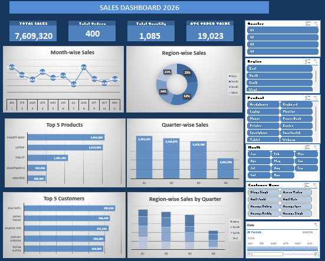

# excel-sales-analysis-dashboard
Interactive Excel sales dashboard built with PivotTables, PivotCharts, slicers and a timeline.

## What it shows
- 4 KPI cards: Total Sales, Total Orders, Total Quantity, Average Order Value
- 6 charts: Month-wise Sales, Region-wise Sales, Top 5 Products, Quarter-wise Sales, Top 5 Customers, Region-wise Sales by Quarter
- 6 filters: Quarter, Region, Product, Month, Customer Name and a Date timeline

## Skills used
- Excel Tables and helper columns (Month, Quarter, Year)
- PivotTables and PivotCharts
- Slicers and Timeline connected to all pivots
- Dashboard layout and chart formatting

## Data
Sample sales dataset (400 orders, Jan to Nov 2026) created for practice.

## Files
- `Sales_Dashboard_2026_v2.xlsx`: the Excel dashboard
- `excel_dashboard.png`: dashboard screenshot

## Author
Ayushi Dubey
